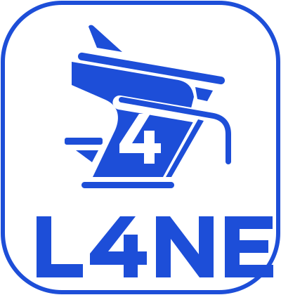

# L4NE Performance (v1.4.0)

<p align="center">
  
</p>

> **MASTER THE WATER. OWN THE LANE.**  
> **SPORTS TECHNOLOGY · TRAINING · ANALYTICS · BUILT TO OUTPERFORM.**

**L4NE Performance** is a local-first, 100% deterministic athletic training protocol logger, live poolside companion, **Segmented PCr Race Predictor**, **Personal Records & Progression Tracker**, and multi-sport performance analytics engine (inspired by **Lane 4** — traditionally the fastest lane in competitive swimming and finswimming).

Featuring 5 persisted athletic themes (**Aquatic Blue**, **Midnight Deep Blue**, **Poolside Navy**, **Athletic Red**, and **Daylight Blue**), the **Custom Maximize Studio** (`0%..100%` intensity slider + 7 independent switches for 60fps falling water droplets, rising pool waves with Lane 4 buoys, rising pennant flags, diving Starting Block #4, 3D Duolingo tactile push buttons, and procedural PCM sounds & haptics), triple concentric **Bevel Performance & Recovery Rings**, and **Horizontal Split Pace Bar Cards**, athletes define reusable training protocols (**Templates**), record executions via the **Left-to-Right Centisecond Numpad** or **Live Poolside Timer**, run the **Segmented PCr Race Recalculator** (`200m` & `400m` predictions), log **Personal Records (`Ρεκόρ`)** to visualize their time-series improvement curve, and integrate with **Apple HealthKit**.

---

## 1. Full v1.4.0 Capability Matrix

| Subsystem | v1.4.0 Implementation Status |
| :--- | :--- |
| **Multi-Platform Rust Core (`l4ne-core` v1.4.0)** | Bundled SQLite (`rusqlite`), SHA-256 Protocol Versioning (`v1 → v2 → vN`), Transactional `delete_template`, Macrocycle `folder_tag`, Homogeneous + Pyramid + Compound Slot Expansion, C-ABI FFI (`l4ne_core.h`) for Swift 6 & JNI (`jni_android.rs`) for Android Kotlin. |
| **Segmented PCr Race Predictor & Recalculator** | Implements `Recovery = 1 - e^(-t/τ)` (`τ = 28s`) and `Δ = k·Recovery + FF` (`k = 0.16` for 200m, `k = 0.13` for 400m). Automatically applies **0% penalty on Segment 1 when `>150m`** (Case Study A `2:53.59`) and symmetric broken penalty (Case Study B `1:17.00`), plus automatic `200m` & `400m` predictions on every template (`4×50m`, `8×50m`, `4×100m`, `6×100m`). |
| **Personal Records & Progression Tab (`Ρεκόρ`)** | Dedicated **`Ρεκόρ` (`PersonalRecordsView`)** tab with `personal_records` SQLite table, tracking Personal Best (`PB`), Initial Baseline, cumulative time/metric delta, percentage improvement (`+X.XX%`), and **Native Swift Charts Time-Series Progression Curve** over time. |
| **Custom Maximize Studio & Procedural Audio** | 5 Blue/Navy/Red/Daylight themes + **`0%..100%` Custom Maximize Slider** & 7 individual switches (`Σταγόνες`, `Κύματα`, `Σημαιάκια`, `Βατήρας #4`, `Animated Icons/Cards`, `3D Duolingo Buttons`, `Procedural PCM Sounds & Haptics`) with zero-lag CoreAnimation scrolling. |
| **Left-to-Right Fast Numpad & Sport Equipment** | Left-to-right centisecond entry (`"3"` → `3.00s`, `"32"` → `32.00s`, `"324"` → `32.40s`, `"3240"` → `32.40s`) and sport-specific equipment catalogs for **Τεχνική Κολύμβηση** (`Μονοπέδιλο`, `Αναπνευστήρας`, `Μάσκα`, `Φιάλη Οξυγόνου`, `Διπλά Πέδιλα`), **Κλασική Κολύμβηση** (`Γυαλάκια`, `Χεράκια`, `Pull Buoy`, `Σανίδα`, `Πεδιλάκια`, `Αλεξίπτωτο`), **Στίβο (Track & Field)**, and **Gym**. |
| **Live Poolside Companion Mode** | High-contrast 62pt monospaced stopwatch using monotonic uptime (`systemUptime`), `0.80s` wet-finger debounce guard, intra-rep **`LAP SPLIT`** turn capture, deterministic **Fixed Rest** & **Send-Off Cycle** countdowns (`-10s`, `-5s`, `3..2..1..`, `DEPART NOW!`), and 1-tap SQLite session save. |
| **Apple HealthKit Read, Write & Lap Prefill** | Read authorization, deterministic workout-to-template matcher, **1-tap Watch Lap Auto-Prefill (`prefill_reps_from_workout_laps`)**, **Write/Export (`HKWorkoutBuilder`)** with duplicate guard, and Daily Recovery Snapshot editor (Sleep, HRV SDNN, Resting HR, VO₂ Max). |
| **Local-First Portability & Schema Contract** | Fail-closed **JSON Backup Export & Full Transactional JSON Restore (`import_json`)** preserving all historical `TemplateVersion` rows (`v1..vN`), JSON Schema 2020-12 contract, **CSV Export**, and live SQLite diagnostics. |

---

## 2. Documentation Index

### Root Documents
- [CHANGELOG.md](CHANGELOG.md) — Chronological release log across `v0.1.0`, `v1.1.0`, and `v1.2.0`.
- [LIVE_CAPABILITIES.md](LIVE_CAPABILITIES.md) — Complete matrix of live timers, formulas, and operational boundaries.
- [HANDOFF.md](HANDOFF.md) — Current engineering snapshot, verified gates, and physical acceptance boundary.
- [CONTRIBUTING.md](CONTRIBUTING.md) — Architectural invariants, TDD policy, and verification workflow.
- [SECURITY.md](SECURITY.md) — Local-first privacy architecture and sensitive-data hygiene.
- [LICENSE](LICENSE) & [TRADEMARK.md](TRADEMARK.md) — GNU GPL v3.0 license and proprietary L4NE Performance trademark protection.

### Technical & Domain Specifications (`docs/`)
- [docs/L4NE_Performance_Project_Overview.md](docs/L4NE_Performance_Project_Overview.md) — Original product discovery & vision specification.
- [docs/ARCHITECTURE_MVP.md](docs/ARCHITECTURE_MVP.md) — System architecture & SQLite DDL blueprint.
- [docs/Architecture.md](docs/Architecture.md) — Component responsibilities and FFI/JNI boundary rules.
- [docs/MATHEMATICAL_SPECIFICATION.md](docs/MATHEMATICAL_SPECIFICATION.md) — Exact formulas for Weighted Pace/100m, StdDev $\sigma$, $\text{CV}\%$, Fatigue Index $\%$, Send-Off Rest $R_i$, SWOLF, Epley 1RM, and Tonnage.
- [docs/CROSS_PLATFORM_DATA_CONTRACT.md](docs/CROSS_PLATFORM_DATA_CONTRACT.md) — Cross-platform JSON & SQLite Schema v3 encoding rules and fail-closed restore limits.
- [docs/contracts/l4ne-backup-v2.schema.json](docs/contracts/l4ne-backup-v2.schema.json) — JSON Schema 2020-12 contract for portable backups.
- [docs/IMPLEMENTATION_STATUS.md](docs/IMPLEMENTATION_STATUS.md) — Source-vs-verified status table across iOS, macOS, Rust, and Android.
- [docs/Deployment.md](docs/Deployment.md) — Xcode device deployment, iOS code signing, and Android NDK cross-compilation.
- [docs/Physical-acceptance.md](docs/Physical-acceptance.md) & [docs/templates/physical-session.md](docs/templates/physical-session.md) — Physical iPhone & poolside acceptance checklist and session record template.

---

## 3. Build & Verification Instructions

Run the complete 4-stage automated verification pipeline (Rust unit tests, optimized `libl4ne_core.a` static build, 7-gate Swift 6 + Rust FFI verification runner, native `L4NETrainingApp` compilation, and `L4NETraining.xcodeproj` generation):

```bash
./scripts/verify.sh
```
