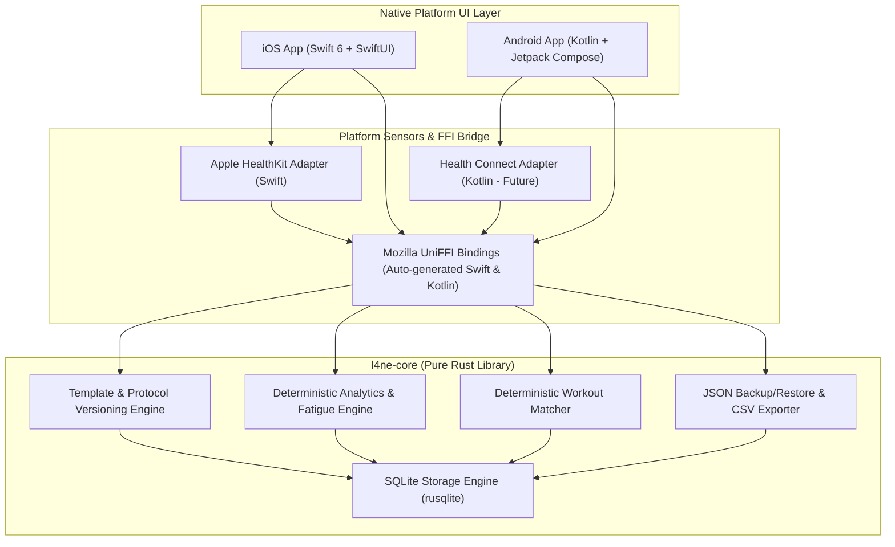

# L4NE Training — Αρχιτεκτονική Συστήματος & Προδιαγραφές MVP (v1.0)

**Parent Brand:** L4NE Performance  
**Product:** L4NE Training (v1.0 MVP)  
**Tagline:** *BUILT TO OUTPERFORM.*  
**Βασική Φιλοσοφία:** Local-first · 100% Deterministic · Zero AI / Zero Cloud · Measurable Athletic Evolution

---

## 1. Συνοπτικός Πίνακας Κλειδωμένων Αποφάσεων

| Τομέας | Επιλογή για το MVP (v1.0) | Επέκταση σε v1.1+ |
| :--- | :--- | :--- |
| **Αρχιτεκτονική & Stack** | **Rust Core (`l4ne-core`)** + **SQLite (`rusqlite`)** + **Mozilla UniFFI** bindings. Native UI σε **SwiftUI (iOS)**. | **Jetpack Compose (Android)** πάνω στον ίδιο ακριβώς Rust πυρήνα. |
| **Εμβέλεια Αθλημάτων** | **Multi-sport Data Model** στη βάση εξαρχής. **UI εστιασμένο 100% σε Κολύμβηση & Τεχνική Κολύμβηση** (Finswimming). | Ενεργοποίηση UI για Στίβο (Track & Field) και Γυμναστήριο (Gym). |
| **Δομή Templates** | Υποστήριξη τόσο για **Ομοιογενή Σετ** (π.χ. `8×50m`) όσο και για **Σύνθετα Σετ / Πυραμίδες** (π.χ. `50-100-150-100-50` ή `4×[2×50 + 100]`). | Template folders, εποχιακά προπονητικά cycles (macrocycles). |
| **Πρωτόκολλο Κολύμβησης** | Απόσταση, Επαναλήψεις, **Rest ΚΑΙ Send-off (Κύκλος)**, Στυλ (Κλασική + Τεχνική), Πισίνα (25m/50m/Open Water), Εξοπλισμός (Monofin, Bifins, Snorkel, κ.λπ.). | Splits ανά 25άρι/50άρι εντός της ίδιας επανάληψης, Stroke Rate (SR). |
| **Καταγραφή (Logging)** | **Post-workout γρήγορη καταχώριση** με custom αθλητικό numpad εκατοστών (`SS.cc` / `M:SS.cc`). | **Live Poolside Mode** (χρονόμετρο, ηχητικό σήμα Send-off & Rest countdown). |
| **Apple HealthKit** | **Read-only στην v1.0:** Εισαγωγή Workouts, HR samples, Ύπνος, HRV, RHR, VO₂ max & Deterministic Matching με Templates. | **Write/Export (`HKWorkout`)** και **Android Health Connect**. |

---

## 2. Αρχιτεκτονική Multi-Platform με Rust Core (`l4ne-core`)

Για να είναι η εφαρμογή ταυτόχρονα **native σε απόδοση** στο iPhone και **έτοιμη για Android** χωρίς διπλογραμμένη λογική, όλη η επιχειρησιακή λογική, η βάση δεδομένων και τα μαθηματικά των analytics υλοποιούνται μία φορά σε **Rust**.



> [!IMPORTANT]
> **Κανόνας Αρχιτεκτονικής:** Το SwiftUI (και αργότερα το Jetpack Compose) **δεν κάνει κανέναν μαθηματικό υπολογισμό** και δεν γράφει απευθείας SQL. Το UI καλεί συναρτήσεις του `l4ne-core` (π.χ. `create_template()`, `log_session()`, `compute_template_analytics()`) και παρουσιάζει έτοιμα, ντετερμινιστικά structs. Τα δεκαδικά δευτερόλεπτα αποθηκεύονται αποκλειστικά ως ακέραια **χιλιοστά του δευτερολέπτου (`duration_ms: i64`)** ώστε να μην υπάρχει ποτέ σφάλμα κινητής υποδιαστολής (floating-point drift).

---

## 3. Μοντέλο Δεδομένων: Απλά Σετ, Πυραμίδες & Ιστορική Ακεραιότητα

### 3.1 Πώς μοντελοποιούνται Απλά Σετ, Πυραμίδες και Σύνθετα Σετ
Κάθε προπονητικό πρωτόκολλο αποτελείται από:
1. **`Template`**: Η ταυτότητα του σετ (π.χ. *"Πυραμίδα Ταχύτητας Monofin"* ή *"8×50m Επιφάνεια @ 30s"*).
2. **`TemplateVersion`**: Κάθε φορά που ο αθλητής αλλάζει μια παράμετρο που επηρεάζει τη φυσιολογία του σετ (απόσταση, διάλειμμα, εξοπλισμός, πισίνα), δημιουργείται νέα `TemplateVersion` (`version_number = 1, 2, ...`). Οι παλιές προπονήσεις παραμένουν συνδεδεμένες με την έκδοση στην οποία εκτελέστηκαν.
3. **`TemplateBlock` (Λίστα Βημάτων)** & **`rounds` (Κύκλοι)**:
   - Ένα `TemplateVersion` έχει `rounds` (π.χ. `1` κύκλος ή `4` κύκλοι) και μια διατεταγμένη λίστα από `TemplateBlock`.
   - Κάθε `TemplateBlock` ορίζει `repeat_count`, `distance_m`, `stroke`, `rest_mode` (`FixedRest` ή `SendOff`) και `rest_duration_ms`.

#### Παραδείγματα Αυτόματης Ανάπτυξης (Deterministic Slot Expansion)
Ο Rust πυρήνας αναπτύσσει (`flattens`) οποιοδήποτε `TemplateVersion` σε μια ντετερμινιστική ακολουθία αναμενόμενων επαναλήψεων (**`ExpectedRepSlot`**):

* **Παράδειγμα 1 — Ομοιογενές Σετ (`8 × 50m Επιφάνεια με Monofin, 30s rest`):**
  * `rounds = 1`, `Block 1: count = 8, distance = 50m, rest = FixedRest(30_000ms)`
  * Παράγει **8 slots** (`Slot #1..#8`, όλα `50m`).
* **Παράδειγμα 2 — Πυραμίδα (`50m - 100m - 150m - 100m - 50m` με αυξανόμενο διάλειμμα):**
  * `rounds = 1`
  * `Block 1: 1×50m @ 20s rest`
  * `Block 2: 1×100m @ 30s rest`
  * `Block 3: 1×150m @ 45s rest`
  * `Block 4: 1×100m @ 30s rest`
  * `Block 5: 1×50m @ 0s rest`
  * Παράγει **5 slots** με αποστάσεις `[50, 100, 150, 100, 50]`.
* **Παράδειγμα 3 — Σύνθετο Σετ Κύκλων (`4 × [2×50m @ 0:50 send-off + 1×100m @ 1:45 send-off]`):**
  * `rounds = 4`
  * `Block 1: 2×50m @ SendOff(50_000ms)`
  * `Block 2: 1×100m @ SendOff(105_000ms)`
  * Παράγει **12 slots** (`Round 1: #1(50m), #2(50m), #3(100m)`, ..., `Round 4: #10(50m), #11(50m), #12(100m)`).

> [!TIP]
> **Γιατί αυτό το μοντέλο λύνει τα πάντα:** Στις πυραμίδες, ο μέσος όρος χρόνου ανά rep δεν έχει νόημα (δεν συγκρίνεις χρόνο 50αριού με 150άρι). Επειδή όμως κάθε `RepRecord` ξέρει το `slot_index` και το `distance_m` του, ο Rust πυρήνας υπολογίζει:
> 1. **Συνολικό Ενεργό Χρόνο (Total Active Time)** όλης της πυραμίδας.
> 2. **Normalized Pace ανά 100m (`sec / 100m`)** σε κάθε βήμα της πυραμίδας.
> 3. **Slot-to-Slot Σύγκριση** (π.χ. το 150άρι της κορυφής της πυραμίδας σήμερα vs το 150άρι της κορυφής την προηγούμενη εβδομάδα).

---

## 4. Πλήρες SQLite Schema (DDL)

Το παρακάτω schema ενσωματώνεται στο `l4ne-core` (μέσω migrations) και υποστηρίζει Multi-sport records, Swimming/Finswimming protocols, Compound Sets και HealthKit snapshots.

```sql
PRAGMA foreign_keys = ON;

-- 1. TEMPLATES (Η ταυτότητα του πρωτοκόλλου)
CREATE TABLE templates (
    id TEXT PRIMARY KEY NOT NULL,              -- UUID v7 (χρονικά ταξινομήσιμο)
    name TEXT NOT NULL,                        -- π.χ. "8x50m Επιφάνεια Ταχύτητα"
    sport_category TEXT NOT NULL,              -- 'swimming' | 'finswimming' | 'track' | 'field' | 'gym'
    pool_length_m INTEGER,                     -- 25, 50, ή NULL (για Open Water / Στίβο / Gym)
    environment TEXT NOT NULL DEFAULT 'pool',  -- 'pool' | 'open_water' | 'track' | 'gym'
    active_version_id TEXT,                    -- Δείκτης στην τρέχουσα έκδοση
    is_archived INTEGER NOT NULL DEFAULT 0,
    created_at_ms INTEGER NOT NULL,
    updated_at_ms INTEGER NOT NULL
);

-- 2. TEMPLATE VERSIONS (Αμετάβλητα snapshots πρωτοκόλλου για ιστορική ακεραιότητα)
CREATE TABLE template_versions (
    id TEXT PRIMARY KEY NOT NULL,              -- UUID v7
    template_id TEXT NOT NULL REFERENCES templates(id) ON DELETE CASCADE,
    version_number INTEGER NOT NULL,           -- 1, 2, 3...
    protocol_hash TEXT NOT NULL,               -- SHA-256 των παραμέτρων (για έλεγχο ισοδυναμίας)
    rounds INTEGER NOT NULL DEFAULT 1,         -- Πόσες φορές επαναλαμβάνεται η ακολουθία των blocks
    round_rest_ms INTEGER NOT NULL DEFAULT 0,  -- Επιπλέον διάλειμμα μεταξύ κύκλων (rounds)
    equipment_json TEXT NOT NULL DEFAULT '[]', -- JSON array: ["monofin", "snorkel", "paddles"]
    target_pace_ms_per_100m INTEGER,           -- Προαιρετικός στόχος ρυθμού (σε ms ανά 100m)
    notes TEXT,
    total_reps INTEGER NOT NULL,               -- Προ-υπολογισμένο σύνολο επαναλήψεων (π.χ. 8 ή 12)
    total_distance_m INTEGER,                  -- Προ-υπολογισμένη συνολική απόσταση (π.χ. 400m)
    is_homogeneous INTEGER NOT NULL,           -- 1 αν όλες οι επαναλήψεις έχουν ίδια απόσταση/στυλ, 0 για πυραμίδες
    created_at_ms INTEGER NOT NULL,
    UNIQUE(template_id, version_number)
);

-- 3. TEMPLATE BLOCKS (Τα βήματα εντός ενός TemplateVersion - υποστηρίζει απλά σετ & πυραμίδες)
CREATE TABLE template_blocks (
    id TEXT PRIMARY KEY NOT NULL,
    template_version_id TEXT NOT NULL REFERENCES template_versions(id) ON DELETE CASCADE,
    block_order INTEGER NOT NULL,              -- 0, 1, 2... σειρά εκτέλεσης εντός του round
    repeat_count INTEGER NOT NULL,             -- π.χ. 8 (για 8x50) ή 1 (για βήμα πυραμίδας)
    record_kind TEXT NOT NULL,                 -- 'timed_distance' | 'distance_attempt' | 'weight_reps'
    distance_m INTEGER,                        -- π.χ. 50, 100, 150 (για swimming / track)
    stroke_or_movement TEXT NOT NULL,          -- π.χ. 'surface', 'apnea', 'immersion', 'bifins', 'freestyle', 'fly'
    rest_mode TEXT NOT NULL,                   -- 'fixed_rest' | 'send_off'
    rest_or_sendoff_ms INTEGER NOT NULL,       -- Σε ms (π.χ. 30000 για 30s rest, ή 90000 για 1:30 send-off)
    target_duration_ms INTEGER,                -- Προαιρετικός χρόνος-στόχος για το συγκεκριμένο block
    UNIQUE(template_version_id, block_order)
);

-- 4. WORKOUTS (Η συνολική προπόνηση της ημέρας - από Apple Watch ή Manual)
CREATE TABLE workouts (
    id TEXT PRIMARY KEY NOT NULL,              -- UUID v7
    sport_category TEXT NOT NULL,
    source_type TEXT NOT NULL,                 -- 'manual' | 'apple_health' | 'health_connect'
    external_source_uuid TEXT UNIQUE,          -- HKWorkout UUID (αποτρέπει διπλές εισαγωγές)
    external_source_name TEXT,                 -- π.χ. "Apple Watch Ultra 2"
    started_at_ms INTEGER NOT NULL,
    ended_at_ms INTEGER,
    duration_ms INTEGER,
    total_distance_m REAL,
    pool_length_m INTEGER,
    active_energy_kcal REAL,
    avg_heart_rate_bpm REAL,
    max_heart_rate_bpm REAL,
    notes TEXT,
    created_at_ms INTEGER NOT NULL
);

-- 5. SESSIONS (Εκτέλεση ενός συγκεκριμένου TemplateVersion)
CREATE TABLE sessions (
    id TEXT PRIMARY KEY NOT NULL,              -- UUID v7
    template_id TEXT NOT NULL REFERENCES templates(id) ON DELETE RESTRICT,
    template_version_id TEXT NOT NULL REFERENCES template_versions(id) ON DELETE RESTRICT,
    workout_id TEXT REFERENCES workouts(id) ON DELETE SET NULL, -- Σύνδεση με συνολικό Workout
    performed_at_ms INTEGER NOT NULL,
    pool_length_m INTEGER,
    is_completed INTEGER NOT NULL DEFAULT 1,
    notes TEXT,
    -- Προ-υπολογισμένα (denormalized) deterministic summary metrics για ακαριαία φόρτωση λιστών:
    total_active_duration_ms INTEGER,
    avg_duration_ms INTEGER,                   -- Για ομοιογενή σετ
    best_rep_duration_ms INTEGER,              -- Για ομοιογενή σετ
    worst_rep_duration_ms INTEGER,             -- Για ομοιογενή σετ
    avg_pace_ms_per_100m INTEGER,              -- Καθολικό metric (λειτουργεί και σε πυραμίδες!)
    std_dev_ms REAL,                           -- Διασπορά (Consistency)
    fatigue_index_pct REAL,                    -- Ποσοστό πτώσης ρυθμού (1ο μισό vs 2ο μισό)
    created_at_ms INTEGER NOT NULL
);

-- 6. REP RECORDS (Κάθε επιμέρους επανάληψη / προσπάθεια εντός ενός Session)
CREATE TABLE rep_records (
    id TEXT PRIMARY KEY NOT NULL,
    session_id TEXT NOT NULL REFERENCES sessions(id) ON DELETE CASCADE,
    slot_index INTEGER NOT NULL,               -- 1..N (θέση στην ανεπτυγμένη ακολουθία)
    round_index INTEGER NOT NULL DEFAULT 1,    -- 1..R
    block_order INTEGER NOT NULL DEFAULT 0,    -- Σε ποιο TemplateBlock ανήκει
    distance_m INTEGER,                        -- Απόσταση της συγκεκριμένης επανάληψης (π.χ. 50, 100, 150)
    duration_ms INTEGER,                       -- Χρόνος σε χιλιοστά δευτερολέπτου (π.χ. 32400 = 32.40s)
    pace_ms_per_100m INTEGER,                  -- (duration_ms * 100) / distance_m
    actual_rest_ms INTEGER,                    -- Πραγματικό διάλειμμα (ιδίως σε Send-off: sendoff_ms - duration_ms)
    stroke_count INTEGER,                      -- Προαιρετικός αριθμός χεριών / δελφινισμών
    rpe INTEGER,                               -- Rate of Perceived Exertion (1-10)
    weight_kg REAL,                            -- Για Gym records
    reps_completed INTEGER,                    -- Για Gym records
    attempt_result_m REAL,                     -- Για Field (άλματα/ρίψεις σε μέτρα)
    is_skipped INTEGER NOT NULL DEFAULT 0,
    notes TEXT,
    UNIQUE(session_id, slot_index)
);

-- 7. DAILY HEALTH SNAPSHOTS (Ημερήσιο context από HealthKit, ανεξάρτητα ή συνδεδεμένα με τη μέρα)
CREATE TABLE daily_health_snapshots (
    date_iso TEXT PRIMARY KEY NOT NULL,        -- 'YYYY-MM-DD' (τοπική ημερομηνία αθλητή)
    sleep_duration_minutes INTEGER,
    hrv_sdnn_ms REAL,
    resting_hr_bpm REAL,
    vo2_max_ml_kg_min REAL,
    source_summary TEXT,                       -- π.χ. "Apple Health (Apple Watch)"
    captured_at_ms INTEGER NOT NULL
);

CREATE INDEX idx_sessions_template_date ON sessions(template_id, performed_at_ms DESC);
CREATE INDEX idx_sessions_version_date ON sessions(template_version_id, performed_at_ms DESC);
CREATE INDEX idx_workouts_date ON workouts(started_at_ms DESC);
```

---

## 5. Deterministic Performance Analytics Engine

Όλοι οι τύποι εκτελούνται στον Rust πυρήνα (`l4ne_core::analytics`) με αυστηρούς μαθηματικούς κανόνες.

### 5.1 Υπολογισμός ανά Session ($N$ έγκυρες επαναλήψεις)
Έστω οι χρόνοι των επαναλήψεων $t_1, t_2, \dots, t_N$ (σε ms) και οι αποστάσεις τους $d_1, d_2, \dots, d_N$ (σε μέτρα):

1. **Συνολικός Ενεργός Χρόνος (Total Active Time):**
   $$T_{\text{total}} = \sum_{i=1}^{N} t_i$$

2. **Μέσος Χρόνος Επανάληψης (μόνο για Ομοιογενή Σετ όπου $d_1 = d_2 = \dots = d_N$):**
   $$\bar{t} = \frac{1}{N} \sum_{i=1}^{N} t_i$$

3. **Σταθμισμένος Μέσος Ρυθμός ανά 100m (Weighted Pace — λειτουργεί ΚΑΙ σε Πυραμίδες):**
   $$P_{100} = \frac{\sum_{i=1}^{N} t_i}{\sum_{i=1}^{N} d_i} \times 100$$

4. **Δείκτης Συνέπειας (Consistency — Τυπική Απόκλιση & Συντελεστής Μεταβλητότητας):**
   - Για ομοιογενή σετ, υπολογίζεται η τυπική απόκλιση χρόνου $\sigma_t = \sqrt{\frac{1}{N}\sum_{i=1}^{N}(t_i - \bar{t})^2}$.
   - Για σύνθετα σετ / πυραμίδες, υπολογίζεται η τυπική απόκλιση του ρυθμού ανά 100m ($\sigma_{P100}$).
   - **Consistency Score (%):** $\text{CV} = \left(\frac{\sigma}{\bar{t}}\right) \times 100$. Όσο πιο κοντά στο `0.0%`, τόσο πιο ρομποτικά σταθερός ο αθλητής.

5. **Δείκτης Κόπωσης (Fatigue / Pace Degradation Index):**
   Συγκρίνει τον μέσο ρυθμό του δεύτερου μισού του σετ ($P_{\text{second\_half}}$) με τον μέσο ρυθμό του πρώτου μισού ($P_{\text{first\_half}}$):
   $$\text{Fatigue (\%)} = \frac{P_{\text{second\_half}} - P_{\text{first\_half}}}{P_{\text{first\_half}}} \times 100$$
   - $\text{Fatigue} > 0\%$: Θετικό split (επιβράδυνση λόγω κόπωσης).
   - $\text{Fatigue} < 0\%$: **Negative split** (ο αθλητής έκλεισε το σετ πιο γρήγορα απ' ό,τι ξεκίνησε).

6. **Πραγματικό Διάλειμμα σε Send-off Mode (Κύκλος Αναχώρησης):**
   Όταν ένα σετ εκτελείται με κύκλο αναχώρησης $S$ (π.χ. `8 × 50m με αναχώρηση κάθε 1:00 = 60.000ms`), το πραγματικό διάλειμμα που κέρδισε ο αθλητής στην επανάληψη $i$ είναι:
   $$R_i = S - t_i$$
   Αν $t_i = 32.40\text{s}$, τότε $R_i = 27.60\text{s}$.

### 5.2 Σύγκριση Μεταξύ Sessions (Improvement & Slot-by-Slot Delta)
Οι συγκρίσεις επιτρέπονται **αυστηρά** μεταξύ sessions που έχουν το ίδιο `template_version_id` (ή το ίδιο `protocol_hash`). Αν ο χρήστης συγκρίνει με παλαιότερη έκδοση του template, το UI εμφανίζει ρητή ένδειξη `PROTOCOL CHANGED (v1 → v2)`.

- **Ποσοστό Βελτίωσης (Improvement %):**
  $$\text{Improvement (\%)} = \frac{T_{\text{baseline}} - T_{\text{current}}}{T_{\text{baseline}}} \times 100$$
  *(όπου θετικό πρόσημο `+6.14%` σημαίνει μείωση χρόνου = ταχύτερη εκτέλεση).*
- **Slot-by-Slot Σύγκριση Πυραμίδας:**
  Για κάθε `slot_index` $k \in \{1 \dots N\}$:
  $$\Delta t_k = t_{k,\text{current}} - t_{k,\text{baseline}}$$
  Έτσι ο αθλητής βλέπει σε γράφημα αν κέρδισε χρόνο στα 50άρια, στα 100άρια ή στο 150άρι της πυραμίδας.

---

## 6. Deterministic Apple HealthKit Matching Algorithm

Όταν ο αθλητής ανοίγει το **Workout Import** στο iOS, η εφαρμογή διαβάζει τα `HKWorkout` που δεν υπάρχουν ήδη στον πίνακα `workouts` (`external_source_uuid`).

Για να προτείνει πιθανά Templates για σύνδεση με το εισερχόμενο Workout **χωρίς AI και χωρίς αυθαιρεσίες**, ο Rust πυρήνας τρέχει έναν ντετερμινιστικό αλγόριθμο βαθμολόγησης συμβατότητας (**Compatibility Rules**):

1. **Φίλτρο Αθλήματος (Hard Rule):** Το `HKWorkoutActivityType` (π.χ. `.swimming`) πρέπει να ταιριάζει με το `sport_category` (`swimming` ή `finswimming`).
2. **Φίλτρο Πισίνας (Hard Rule):** Αν το `HKWorkout` περιέχει metadata `HKMetadataKeyLapLength` (π.χ. `25m` ή `50m`), προτείνονται κατά προτεραιότητα τα Templates με το ίδιο `pool_length_m`.
3. ** Έλεγχος Απόστασης (Volume Rule):**
   - Ένα συνολικό κολυμβητικό workout (π.χ. `2.400m`) συνήθως περιλαμβάνει προθέρμανση, 1 έως 3 κύρια σετ (Templates) και αποθεραπεία.
   - Επομένως, το `template.total_distance_m` (π.χ. `400m` για ένα `8×50m`) πρέπει να είναι $\le \text{workout.total\_distance\_m}$.
   - Ο χρήστης μπορεί να συνδέσει **ένα ή περισσότερα** εκτελεσμένα Sessions (Templates) κάτω από το ίδιο `workout_id` (όπως φαίνεται στο Daily Timeline: `2,400m · Associated templates: 3`).
4. **Εξαγωγή Splits (αν υπάρχουν `HKWorkoutEvent` / Laps):**
   - Αν το Apple Watch έχει καταγράψει επιμέρους laps/segments που ταιριάζουν σε απόσταση με τα blocks του επιλεγμένου Template, η εφαρμογή προ-συμπληρώνει τους χρόνους προς επιβεβαίωση.
   - Αν το Apple Watch έχει μόνο τη συνολική απόσταση και διάρκεια (το πιο συνηθισμένο στην τεχνική κολύμβηση με monofin), το Workout συνδέεται για το Heart Rate & Volume context, και ο αθλητής πληκτρολογεί τους ακριβείς χρόνους των επαναλήψεων με το custom numpad.

---

## 7. Ταχύτατη Καταχώριση στο Κινητό (Athletic Centisecond Numpad)

Επειδή στην v1.0 η καταχώριση των επαναλήψεων γίνεται χειροκίνητα μετά το σετ, η εμπειρία πληκτρολόγησης πρέπει να παίρνει **λιγότερο από 10 δευτερόλεπτα για ένα σετ 8×50m**:

- **Χωρίς τελείες και άνω-κάτω τελείες:** Ο χρήστης πατάει μόνο ψηφία σε ένα custom numpad στο κάτω μέρος της οθόνης:
  - Πατάει `3` `2` `4` `0` $\rightarrow$ μορφοποιείται αυτόματα ως **`32.40s`** (`32.400 ms`).
  - Πατάει `1` `0` `8` `5` `5` $\rightarrow$ μορφοποιείται αυτόματα ως **`1:08.55`** (`68.550 ms`).
- **Auto-advance & Copy Previous:**
  - Κουμπί **`NEXT REP (⏎)`** που αποθηκεύει την επανάληψη και πηγαίνει αμέσως στο επόμενο slot.
  - Κουμπί **`±0.1s` / `SAME AS PREV`** για περιπτώσεις που ο αθλητής έκανε σχεδόν ίδιο χρόνο στην επόμενη επανάληψη.
  - Live εμφάνιση του **Actual Rest** (αν το σετ είναι σε Send-off mode) και του **Running Average** την ώρα που πληκτρολογεί.

---

## 8. Στρατηγική Άδειας Χρήσης (Open Source & Ιδιοκτησία Κώδικα/Brand)

Με βάση την απαίτησή σου: **«να μπορούν να το κατεβάσουν δωρεάν, αλλά ο κώδικας, το brand και ο τρόπος ανάπτυξης να ανήκουν αποκλειστικά σε εμένα»**, υπάρχουν δύο ξεκάθαρες νομικές επιλογές για το GitHub repository του **L4NE Performance**:

### Επιλογή Α: Αυστηρό Copyleft Open-Source (`GPL-3.0-only`) + Trademark Policy (Προτεινόμενη για Open Source)
- **Πώς λειτουργεί:** Δημοσιεύεις τον κώδικα με άδεια **GNU GPL v3.0** και κρατάς **100% το Copyright** στο όνομά σου (δεν δέχεσαι εξωτερικά Pull Requests χωρίς Contributor License Agreement ή κρατάς το repo ως *open-code / single-author*).
- **Τι προστατεύει:**
  1. Οποιοσδήποτε μπορεί να κατεβάσει τον κώδικα δωρεάν, να τον διαβάσει και να τον κάνει compile στο δικό του iPhone.
  2. **Απαγορεύεται** σε οποιαδήποτε εταιρεία ή developer να πάρει τον κώδικά σου και να τον βάλει σε κλειστή/εμπορική εφαρμογή στο App Store.
  3. Προσθέτεις ένα αρχείο `TRADEMARK.md` που ορίζει ρητά ότι το όνομα **L4NE Performance**, **L4NE Training** και το λογότυπο **L4NE** είναι αποκλειστική σου ιδιοκτησία και δεν καλύπτονται από την άδεια του κώδικα.

### Επιλογή Β: Source-Available / Non-Commercial (`PolyForm Noncommercial 1.0.0`)
- **Πώς λειτουργεί:** Ο κώδικας είναι δημόσιος στο GitHub, ο καθένας μπορεί να τον κατεβάσει δωρεάν για προσωπική/αθλητική χρήση, αλλά **απαγορεύεται ρητά οποιαδήποτε εμπορική χρήση ή αναδιανομή επί πληρωμή** από τρίτους.
- **Διαφορά από την Επιλογή Α:** Δεν επιτρέπει σε τρίτους να πουλήσουν τον κώδικα ακόμη κι αν ανοίξουν τον δικό τους κώδικα. Μόνο εσύ (ως κάτοχος του Copyright) έχεις το δικαίωμα να διαθέσεις την επίσημη εφαρμογή εμπορικά στο App Store.

---

## 9. Δομή Φακέλων του Project (Monorepo)

Προτεινόμενη δομή για το repository `L4NE-Training`:

```text
L4NE-Training/
├── LICENSE
├── TRADEMARK.md
├── README.md
├── Cargo.toml                      # Rust Workspace
├── crates/
│   └── l4ne-core/                  # Ο κοινός Rust πυρήνας (iOS & Android)
│       ├── Cargo.toml
│       └── src/
│           ├── lib.rs              # UniFFI exports
│           ├── db/                 # SQLite schema & migrations
│           ├── models/             # Template, TemplateVersion, Block, Session, RepRecord
│           ├── engine/             # Slot expansion (Απλά σετ & Πυραμίδες) & protocol hashing
│           ├── analytics/          # Deterministic math, fatigue, consistency, comparisons
│           ├── matcher/            # Deterministic HealthKit / Health Connect workout matching
│           └── export/             # JSON backup/restore & CSV export
├── ios/
│   └── L4NETraining/               # Native Swift 6 + SwiftUI iOS App
│       ├── App/
│       ├── Theme/                  # L4NE Dark/Anthracite + Electric Lime Design System
│       ├── CoreBridge/             # Generated Swift bindings από το l4ne-core
│       ├── HealthKit/              # HealthKit permissions & reader
│       └── Features/
│           ├── Dashboard/
│           ├── Templates/          # Template Builder (Simple & Pyramid/Compound)
│           ├── SessionLogging/     # Athletic Centisecond Numpad
│           ├── Analytics/          # Charts & Slot-by-Slot Comparisons
│           ├── Timeline/           # Daily Training Timeline & Health Context
│           └── Settings/
└── android/                        # Έτοιμο placeholder για μελλοντικό Jetpack Compose UI
    └── README.md
```
